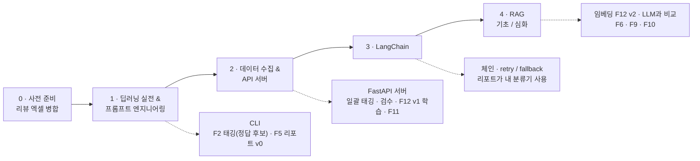

<div align="center">

# 🔎 sellerlens

**직접 수집한 리뷰로 학습시킨 내 모델로, 소싱 판단의 근거를 정리해 주는 리뷰 분석기**

KANT 강의 4과목을 순서대로 학습하면서, 배운 것을 바로 이 도구에 구현한다.


-000000?logo=ollama&logoColor=white)


[현황](docs/STATUS.md) · [기획서](docs/PLAN.md) · [설계](docs/DESIGN.md) · [로드맵](docs/ROADMAP.md) · [커리큘럼](docs/CURRICULUM.md) · [기능 진행 현황](docs/FEATURES.md) · [학습 일지](docs/days/) · [코딩 컨벤션](docs/CONVENTIONS.md)

</div>

---

## ✨ 만들 기능

소싱 후보 상품의 리뷰 엑셀을 넣으면 **별점 분포와 실제 구매자가 말한 좋은 점·나쁜 점**을 근거 리뷰와 함께 요약한다. 소싱 판단은 내가 하고, 도구는 판단 근거만 정리한다. 리뷰 분류는 **내가 학습시킨 분류기**로 하고, 같은 평가셋에서 LLM과 비교한다. 목적과 결과물 예시는 [docs/PLAN.md](docs/PLAN.md).

| | 기능 | 쓰는 장면 |
|---|---|---|
| F1 | 📥 리뷰 통합·정제 | 수집한 엑셀을 하나로 합치고 개인정보를 지운다 |
| F2 | 🏷️ 리뷰 태깅 | LLM이 리뷰마다 감성 · 좋은 점 유형 · 나쁜 점 유형 · 근거 문장을 붙인다. 검수해서 내 모델의 정답으로 쓴다 |
| F12 | 🧠 내 리뷰 분류기 | 검수한 정답으로 학습한 분류기. 평가셋에서 LLM 태깅과 비교한다 |
| F5 | 📊 상품 리뷰 리포트 | 별점 분포, 좋은 점·나쁜 점 Top과 대표 리뷰, 5점인데 불만·최근 추이·옵션별 차이 |
| F6 | 🔍 리뷰 근거 검색 | "코팅 벗겨진다는 리뷰 보여줘" → 원문 |
| F10 | ⚖️ 상품 비교 | 후보 2~3개를 한 표로 |
| F11 | 💰 금액 계산 | 원가·판매가·수수료 → 마진, 마진율 |
| F9 | 🤖 리뷰 어시스턴트 | 통계·금액 질문은 계산 도구로, 근거 질문은 검색으로 자동 분기 |

F1·F2·F12·F5가 핵심이고 나머지는 확장이다. 진행 상황은 [docs/FEATURES.md](docs/FEATURES.md), 제외한 기능과 나중에 할 기능은 [docs/ROADMAP.md](docs/ROADMAP.md)에 있다.

## 🗺️ 학습 → 개발 흐름



장별 실습 과제와 완료 기준은 [docs/CURRICULUM.md](docs/CURRICULUM.md)에 있다.

## 📒 하루 기록 방식

**Day 번호 하나로 모든 기록이 대응한다.** Day 번호는 장 번호와 같다 (1과목 Day05부터. 8장 = Day08).

| 노션 📒 sellerlens 개발 일지 | 저장소 |
|---|---|
| `DayNN - 그날 배운 내용 한 문장` | `docs/days/dayNN.md` (원본) |
| 본문의 실습 | `labs/dayNN/` |
| `기능` 속성 (F1~F12 · 공통) | `docs/FEATURES.md` 의 Day 기록 |
| `git` 속성 | 태그 `dayNN` (그날 끝난 시점의 코드) |

- **저장소가 원본**이고, 노션은 같은 내용의 복습용 사본이다 (저장소 → 노션 단방향).
- 헷갈리면 VS Code에서 `Ctrl/Cmd + P` → `dayNN`을 입력한다.
- 그날 버전 그대로 보기: `git checkout dayNN`
- 그날 바뀐 코드: `git diff day<N-1> day<N> -- src/`
- 하루 끝에 **"마무리"** 라고 하면 커밋 → `dayNN` 태그 → 푸시 → 노션 반영까지 한 번에 진행된다 ([.claude/skills/day-wrap](.claude/skills/day-wrap/SKILL.md)).

## 📁 구조

```
sellerlens/
├─ data/
│  ├─ raw/reviews/       원본 리뷰 엑셀 (상품별)
│  └─ processed/         정제 결과
├─ labs/dayNN/           Day별 실습 — 배우는 곳 (그날 이후 고정)
├─ src/                  서비스 코드 — 쌓아 가는 곳
├─ docs/
│  ├─ STATUS.md          현황 (기획 · 설계 · 진행 사항 한 장)
│  ├─ PLAN.md            기획서 (목적 · 기능 · 완료 기준 · 리스크)
│  ├─ DESIGN.md          설계 (데이터 흐름 · 태깅 스키마 · 모듈 구조)
│  ├─ ROADMAP.md         기능 목록 · 추후 진행
│  ├─ CURRICULUM.md      과목·장별 학습/개발 계획
│  ├─ FEATURES.md        기능별 진행 현황
│  ├─ CONVENTIONS.md     코딩 컨벤션 (파일 구성, 이름, 함수, 경로, 검증)
│  └─ days/              Day별 학습 일지 (dayNN.md, _template.md)
└─ .claude/skills/day-wrap/   하루 기록 → 커밋·태그·푸시 → 노션 반영 절차
```

## 🚀 시작하기 (Windows · Mac 공통)

[uv](https://docs.astral.sh/uv/)와 Python 3.12가 필요하다.

```bash
git clone https://github.com/ho-yu/seller-lens.git
cd seller-lens
uv sync
```

VS Code로 폴더를 열면 `.venv` 인터프리터가 자동으로 잡힌다. 스크립트는 `uv run python <파일>`로 실행한다.

## 🔒 원칙

- **판단은 사람이 한다.** 도구는 추천이나 판정을 하지 않고 근거만 정리한다.
- **숫자는 코드가 센다.** 별점 분포, 건수, 추이, 마진은 코드로 계산하고 LLM은 읽고 묶는 일만 한다.
- **근거를 남긴다.** 요약 항목마다 근거 리뷰를 붙이고, 근거가 없으면 쓰지 않는다.
- **측정한다.** 직접 라벨 붙인 평가셋으로 개선 전후를 숫자로 비교한다. 평가셋은 학습에 섞지 않는다.
- **개인정보는 넣지 않는다.** 리뷰어 이름·번호는 정제 단계에서 지우고, 로컬 LLM(Ollama)을 기본으로 쓴다.
