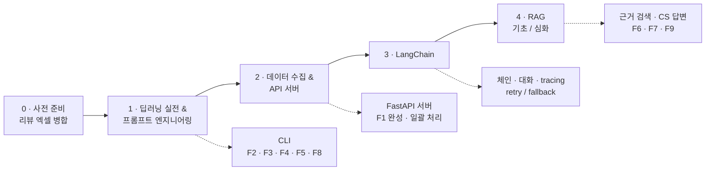

<div align="center">

# 🔎 sellerlens

**셀러가 리뷰와 고객 문의를 빠르게 처리하도록 돕는 개인용 도구**

KANT 강의 4과목을 순서대로 학습하면서, 배운 것을 바로 이 도구에 구현한다.


-000000?logo=ollama&logoColor=white)


[로드맵](docs/ROADMAP.md) · [커리큘럼](docs/CURRICULUM.md) · [기능 진행 현황](docs/FEATURES.md) · [학습 일지](docs/days/) · [코딩 컨벤션](docs/CONVENTIONS.md)

</div>

---

## ✨ 만들 기능

리뷰 엑셀을 넣으면 셀러가 매일 하는 일을 줄여 준다. 모든 결과는 **초안**이고, 등록은 셀러가 직접 한다.

| | 기능 | 셀러가 쓰는 장면 |
|---|---|---|
| F1 | 📥 리뷰 통합·정제 | 상품별·기간별 엑셀을 하나로 합치고 개인정보를 지운다 |
| F2 | 🏷️ 리뷰 자동 태깅 | 리뷰마다 감성 · 불만 유형 · 긴급도 · 근거 문장을 붙인다 |
| F3 | 🚨 대응 우선순위 큐 | 오늘 볼 리뷰만 긴급도 순으로. 5점인데 불만인 리뷰도 잡아낸다 |
| F4 | 💬 리뷰 답글 초안 | 응답 정책(보상 확약 금지, 정해진 톤)을 지키는 답글 초안 |
| F5 | 📊 상품 리뷰 리포트 | 상품·옵션·기간별 불만 순위와 추이, 대표 리뷰 인용 |
| F6 | 🔍 리뷰 근거 검색 | "네이비 옵션 사이즈 불만만 보여줘" → 원문과 출처 |
| F7 | 🎧 CS 문의 답변 초안 | 정책·FAQ 근거로 답변, 근거가 없으면 "담당자 확인 필요" |
| F8 | 📣 판매 소구점 추출 | 긍정 리뷰 속 실제 고객 표현을 상세페이지 문구 소재로 |
| F9 | 🤖 셀러 어시스턴트 | 통계 질문은 집계 도구로, 근거 질문은 RAG로 자동 분기 |

진행 상황은 [docs/FEATURES.md](docs/FEATURES.md), 강의 범위 밖이라 나중에 할 기능은 [docs/ROADMAP.md](docs/ROADMAP.md)에 있다.

## 🗺️ 학습 → 개발 흐름



장별 실습 과제와 완료 기준은 [docs/CURRICULUM.md](docs/CURRICULUM.md)에 있다.

## 📒 하루 기록 방식

**Day 번호 하나로 모든 기록이 대응한다.**

| 노션 📒 sellerlens 개발 일지 | 저장소 |
|---|---|
| `DayNN - 그날 배운 내용 한 문장` | `docs/days/dayNN.md` (원본) |
| 본문의 실습 | `labs/dayNN/` |
| `기능` 속성 (F1~F9 · 공통) | `docs/FEATURES.md` 의 Day 기록 |
| `git` 속성 | 태그 `dayNN` (그날 끝난 시점의 코드) |

- **저장소가 원본**이고, 노션은 같은 내용의 복습용 사본이다 (저장소 → 노션 단방향).
- 헷갈리면 VS Code에서 `Ctrl/Cmd + P` → `dayNN`을 입력한다.
- 그날 버전 그대로 보기: `git checkout dayNN`
- 그날 바뀐 코드: `git diff day<N-1> day<N> -- src/`
- 하루 끝에 **"마무리"** 라고 하면 커밋 → `dayNN` 태그 → 푸시 → 노션 반영까지 한 번에 진행된다 ([.claude/skills/day-wrap](.claude/skills/day-wrap/SKILL.md)).

## 📁 구조

```
sellerlens/
├─ data/
│  ├─ raw/reviews/       원본 리뷰 엑셀 (상품별)
│  └─ processed/         정제 결과
├─ labs/dayNN/           Day별 실습 — 배우는 곳 (그날 이후 고정)
├─ src/                  서비스 코드 — 쌓아 가는 곳
├─ docs/
│  ├─ ROADMAP.md         기능 목록 · 추후 진행
│  ├─ CURRICULUM.md      과목·장별 학습/개발 계획
│  ├─ FEATURES.md        기능별 진행 현황
│  ├─ CONVENTIONS.md     코딩 컨벤션 (파일 구성, 이름, 함수, 경로, 검증)
│  └─ days/              Day별 학습 일지 (dayNN.md, _template.md)
└─ .claude/skills/day-wrap/   하루 기록 → 커밋·태그·푸시 → 노션 반영 절차
```

## 🚀 시작하기 (Windows · Mac 공통)

[uv](https://docs.astral.sh/uv/)와 Python 3.12가 필요하다.

```bash
git clone https://github.com/ho-yu/seller-lens.git
cd seller-lens
uv sync
```

VS Code로 폴더를 열면 `.venv` 인터프리터가 자동으로 잡힌다. 스크립트는 `uv run python <파일>`로 실행한다.

## 🔒 원칙

- **사람이 최종 확인한다.** 답글, CS 답변, 문구는 모두 초안이다.
- **개인정보는 넣지 않는다.** 리뷰어 이름·번호는 정제 단계에서 지우고, 로컬 LLM(Ollama)을 기본으로 쓴다.
- **근거를 남긴다.** 결과에는 근거가 된 리뷰나 문서를 붙이고, 근거가 없으면 답하지 않는다.
- **측정한다.** 평점 라벨과 직접 만든 평가셋으로 개선 전후를 숫자로 비교한다.
