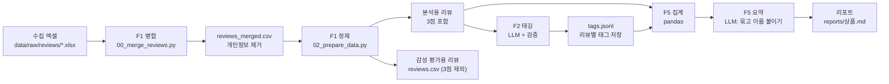

# sellerlens 설계

> 기획([PLAN.md](PLAN.md))의 핵심 결과물인 **상품 리뷰 리포트(F5)**를 만들기 위한 데이터 흐름, 저장 형식, 태깅 스키마, 모듈 구조를 정한다. (작성: 2026-11-20, 초안)
> 지금까지는 강의 실습에서 만든 함수만 `src/`로 옮겨 왔고 전체 설계는 없었다. 이 문서가 첫 설계다.
> `결정 필요`로 표시한 곳은 정하기 전까지 초안이다. 정하면 이 문서를 고친다.

## 1. 전체 흐름



**역할 나누기 (PLAN 원칙: 숫자는 코드가 센다)**

| 단계 | 누가 | 하는 일 |
|---|---|---|
| 병합·정제 | 코드 | 엑셀 합치기, 개인정보·중복·빈 본문 제거 |
| 태깅 | LLM | 리뷰 1건 → 감성, 좋은 점·나쁜 점과 근거 문장 |
| 검증 | 코드 | 문법 → 구조(Pydantic) → 업무 규칙(근거 문장이 원문에 있는가) |
| 집계 | 코드 | 별점 분포, 비율, 유형별 건수, 추이, 옵션별 차이 |
| 요약 | LLM | 같은 유형의 근거 문장들을 보고 한 줄 이름 붙이기 ("코팅이 벗겨진다") |
| 대표 리뷰 선택 | 코드 | 유형별로 근거가 확인된 리뷰 중에서 고른다 |

## 2. 데이터

### 지금 있는 파일

| 파일 | 건수 | 컬럼 | 비고 |
|---|---|---|---|
| `data/raw/reviews/product_01~05.xlsx` | 상품 5개 | 원본 | git 제외. 파일마다 컬럼 이름이 달라 병합 때 맞춘다 |
| `data/interim/reviews_merged.csv` | 2,951 | product_id, 작성일, 판매자, 상품옵션명, 평점, 리뷰제목, 리뷰내용, 사진수, 도움, 도움된인원수, 도움돼요 수, 리뷰ID | 개인정보만 지운 병합본 |
| `data/processed/reviews.csv` | 2,076 | product_id, 작성일, 상품옵션명, 평점, text, label | 빈 행·중복 제거, **3점 제외**, label(부정 1 / 긍정 0) |

### 문제: 지금 `reviews.csv`로는 리포트를 만들 수 없다

`reviews.csv`는 Day06 감성 분류 평가용으로 만든 파일이다. 리포트에 쓰려면 세 가지가 맞지 않는다.

1. **3점 리뷰가 없다.** 별점 분포가 틀리게 나온다. 다만 병합본의 3점 67건 중 본문이 있는 것은 9건뿐이라, 태깅에 더해지는 리뷰는 적다.
2. **`리뷰ID`가 없다.** 리포트의 근거 리뷰를 원문으로 따라갈 수 없다.
3. **`label`은 평점에서 만든 값이다.** 리포트의 감성은 LLM 태깅 결과를 써야 한다 (Day06: 4점인데 내용은 불만인 리뷰가 있었다).

**제안:** 정제 결과를 두 파일로 나눈다. `결정 필요`

| 파일 | 용도 | 차이 |
|---|---|---|
| `data/processed/reviews_all.csv` (신규) | 리포트·검색 | 3점 포함, `review_id` 포함, label 없음 |
| `data/processed/reviews.csv` (유지) | 감성 분류 평가 (Day06 실습) | 지금 그대로 |

### 분석용 리뷰 컬럼 (`reviews_all.csv`)

| 컬럼 | 형식 | 예 | 쓰는 곳 |
|---|---|---|---|
| review_id | str | 원본 리뷰ID | 근거 추적, 태그와 연결 |
| product_id | str | product_05 | 상품별 리포트 |
| written_at | 날짜 | 2026-08-08 | 추이 (원본 형식 `YYYY.MM.DD`와 `YYYY-MM-DD`를 하나로 맞춘다) |
| option | str | 28cm | 옵션별 차이 |
| rating | int 1~5 | 4 | 별점 분포 |
| text | str | 제목 + 본문 | 태깅 입력 |

### 평가 데이터

| 평가셋 | 내용 | 상태 |
|---|---|---|
| 감성 60건 | 2점 30 / 4점 30, 평점 라벨 | 있음 (Day06) |
| 유형 라벨 200건 | 내가 직접 좋은 점·나쁜 점 유형을 붙인 리뷰 | 없음. 평가셋 보강용으로 수집한 669건에서 뽑는다 |

평가셋은 학습·분석용 데이터에 합치지 않고 별도 파일로 둔다.

## 3. 태깅 스키마 v2 (F2)

지금 `src/tagging.py`의 `ReviewTag`는 예전 방향(답글·대응) 기준이다. **불만 1개 + 긴급도**만 담는다. 리포트에는 리뷰 하나에 좋은 점·나쁜 점이 여러 개 들어가야 하므로 바꾼다.

```python
class Aspect(BaseModel):          # 좋은 점 또는 나쁜 점 하나
    type: str                     # 아래 유형 목록 중 하나 (Literal)
    evidence: str                 # 리뷰 원문에 있는 근거 문장

class ReviewTagV2(BaseModel):
    sentiment: Literal["부정", "중립", "긍정"]
    pros: list[Aspect]            # 없으면 []
    cons: list[Aspect]            # 없으면 []
```

| 바뀌는 것 | 전 (v1) | 후 (v2) |
|---|---|---|
| 불만 | `complaint_type` 1개 | `cons` 여러 개, 각각 근거 |
| 좋은 점 | 없음 | `pros` 여러 개, 각각 근거 |
| 긴급도 | `urgency` 1~3 | 삭제 (대응 큐 F3 제외) |

**유형 목록 (초안, `결정 필요`).** 실제 리뷰 100건쯤 읽고 고친다. 상품 카테고리마다 다를 수 있다.

| 나쁜 점 | 좋은 점 |
|---|---|
| 품질·내구성, 파손·불량, 사이즈·호환, 사용성, 소재·냄새, 배송·포장, 가격, 기타 | 품질·마감, 성능·기능, 사용 편의, 디자인, 가성비, 배송·포장, 기타 |

**검증 3단계 (Day07 그대로)**: JSON 문법 → Pydantic 구조 → 업무 규칙(각 `evidence`가 원문에 있는가). 실패하면 그 리뷰만 다시 태깅하고, 그래도 실패하면 `ok: false`로 저장해 리포트에서 뺀다.

## 4. 태깅 결과 저장

2천 건을 매번 다시 태깅하면 느리다. 리뷰별 결과를 한 줄씩 저장하고, 이미 태깅한 리뷰는 건너뛴다.

`data/processed/tags.jsonl` (한 줄 = 리뷰 1건)

```json
{"review_id": "…", "prompt_version": "v2", "ok": true, "errors": [], "tag": {"sentiment": "부정", "pros": [], "cons": [{"type": "품질·내구성", "evidence": "박음질이 한 달 만에 풀렸어요"}]}}
```

- 스키마나 프롬프트를 바꾸면 `prompt_version`을 올리고 다시 태깅한다.
- 모델 이름도 같이 남길지는 `결정 필요` (모델을 바꿔 비교할 때 필요).

## 5. 리포트 계산 (F5)

| 리포트 항목 | 계산 (코드) | 입력 |
|---|---|---|
| 별점 분포, 평균 | 평점별 건수와 비율 | reviews_all |
| 감성 비율 | 태그의 sentiment 비율 | tags |
| 좋은 점·나쁜 점 Top N | 유형별 언급 리뷰 수 | tags |
| 유형 이름 붙이기 | LLM이 근거 문장 묶음을 한 줄로 요약 (숫자는 넘겨 주기만 한다) | tags |
| 대표 리뷰 | 유형별 근거가 확인된 리뷰 중 고른다 (기준 `결정 필요`: 최근 순 / 도움 수 순) | tags + reviews_all |
| 5점인데 불만 | 평점 5 이고 cons가 있는 리뷰 수와 예 | 둘 다 |
| 최근 추이 | 최근 3개월과 그 이전의 부정 비율 비교 | 둘 다 |
| 옵션별 차이 | 옵션별 나쁜 점 유형 비율 | 둘 다 |

- 출력은 마크다운 파일 `reports/<product_id>.md` 한 장.
- 리포트 맨 아래에 "리뷰 관점의 근거이며 가격·마진·판매량은 포함하지 않는다"를 적는다.
- 리뷰 수가 적은 상품(예: 30건 미만)은 비율 옆에 건수를 같이 보여 준다. 기준 숫자는 `결정 필요`.

## 6. 모듈 구조

| 파일 | 역할 | 상태 | 언제 |
|---|---|---|---|
| `src/00_merge_reviews.py` | F1 병합 | 있음 | Day01·05 |
| `src/02_prepare_data.py` | F1 정제 → `reviews.csv` | 있음. `reviews_all.csv` 출력 추가 필요 | 다음 데이터 작업 |
| `src/llm.py` | LLM 호출 (messages, few-shot, ask) | 있음 | Day05·06 |
| `src/evaluation.py` | 혼동 행렬 수, 재현율·정밀도·F1 | 있음 | Day06 |
| `src/tagging.py` | 태깅 스키마와 검증 | 있음 (v1). v2로 교체 필요 | Day07 → 다음 태깅 작업 |
| `src/report.py` | F5 집계 함수와 리포트 조립 | 없음 | 1과목 8~10장 |
| `src/tools.py` | Tool Calling 도구 등록 (집계·금액 함수) | 없음 | 1과목 8장 실습에서 옮김 |
| `src/cli.py` | `태깅` / `리포트` 명령 | 없음 | 1과목 10장 |
| `src/pricing.py` | F11 마진 계산 | 없음 | 2과목 |
| `src/api.py` | FastAPI (업로드, 태깅, 리포트, 금액) | 없음 | 2과목 5~7장 |

CLI 모양 (초안): `uv run python src/cli.py tag product_05` → `uv run python src/cli.py report product_05`

## 7. LLM 설정

| 항목 | 값 | 이유 |
|---|---|---|
| 모델 | Ollama `qwen3:4b-instruct-2507-q4_K_M` | Day04에서 비교해 골랐다. 로컬이라 리뷰가 밖으로 나가지 않는다 |
| 호출 | OpenAI SDK, `http://localhost:11434/v1` | Day05 |
| temperature | 태깅 0, 요약 0~0.3 | 같은 리뷰는 같은 태그가 나와야 한다 |
| 출력 형식 | 스키마를 `response_format`으로 넘긴다 | Day07: 프롬프트만 주면 구조 통과 0/3, 스키마를 주면 3/3 |
| 실패 처리 | timeout, retry, 실패한 리뷰만 다시 | 1과목 10장 · 3과목 9장 |

## 8. 결정 필요 목록

1. 정제 결과를 `reviews_all.csv`(리포트용)와 `reviews.csv`(평가용)로 나눌지
2. 좋은 점·나쁜 점 유형 목록 (리뷰 100건쯤 읽고 확정)
3. 대표 리뷰 고르는 기준 (최근 순 / 도움 수 순)
4. 태깅 결과에 모델 이름도 남길지
5. 리뷰 수가 적은 상품의 표시 기준
